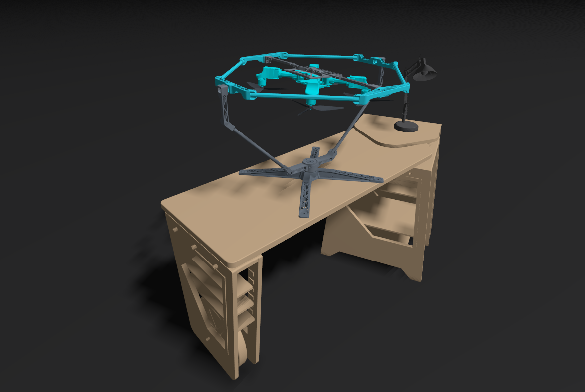
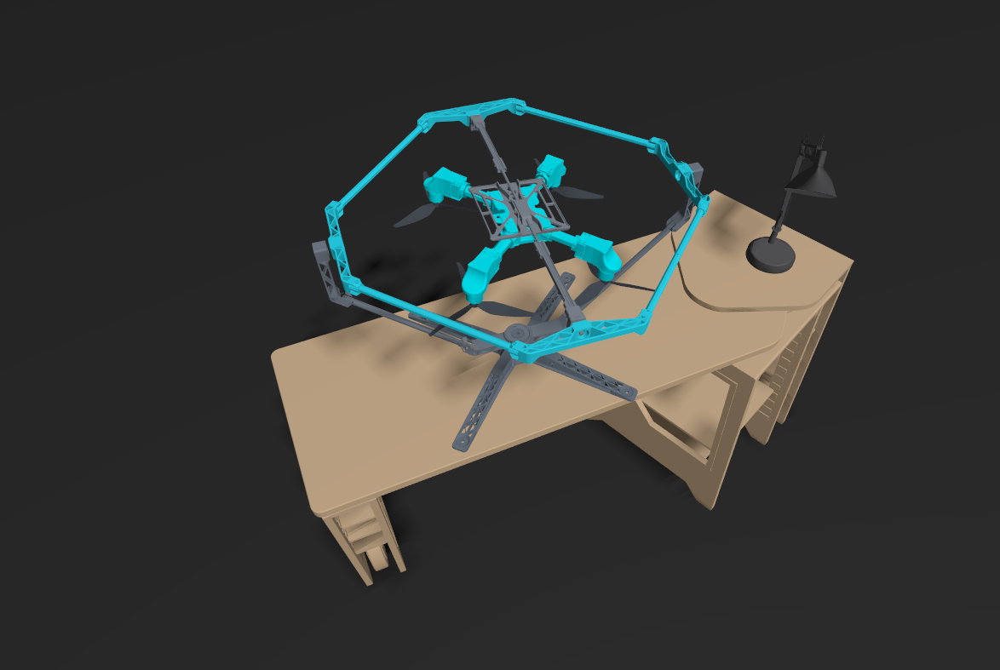
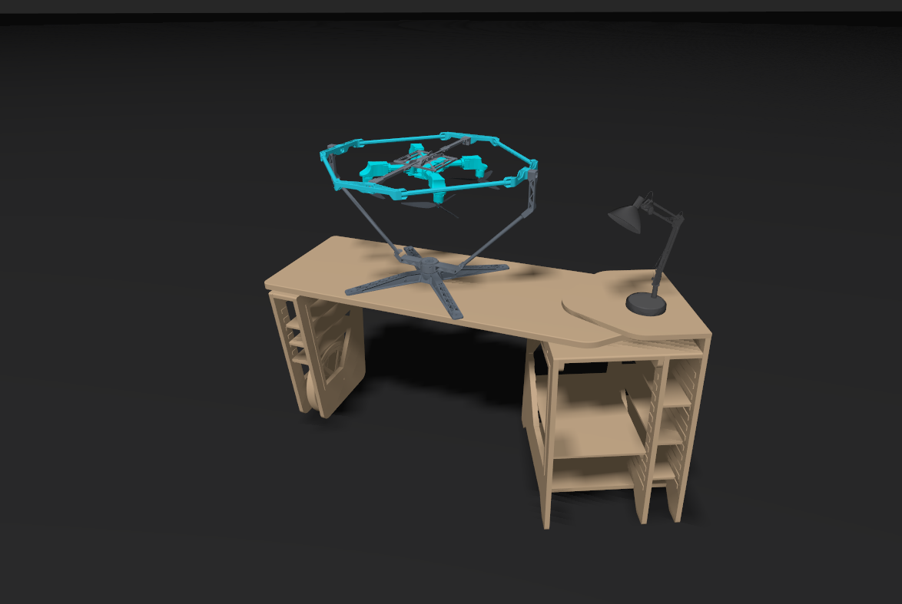
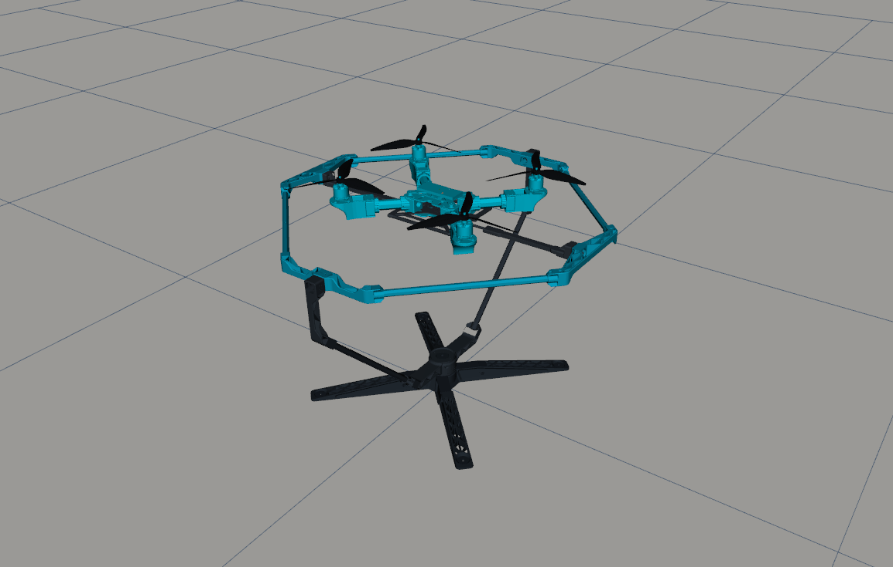
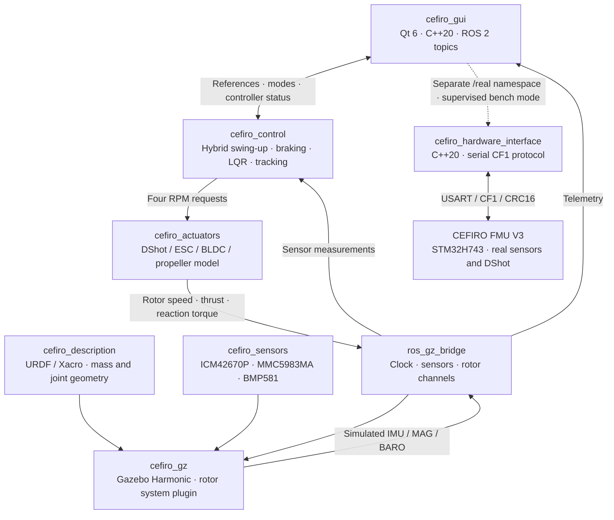
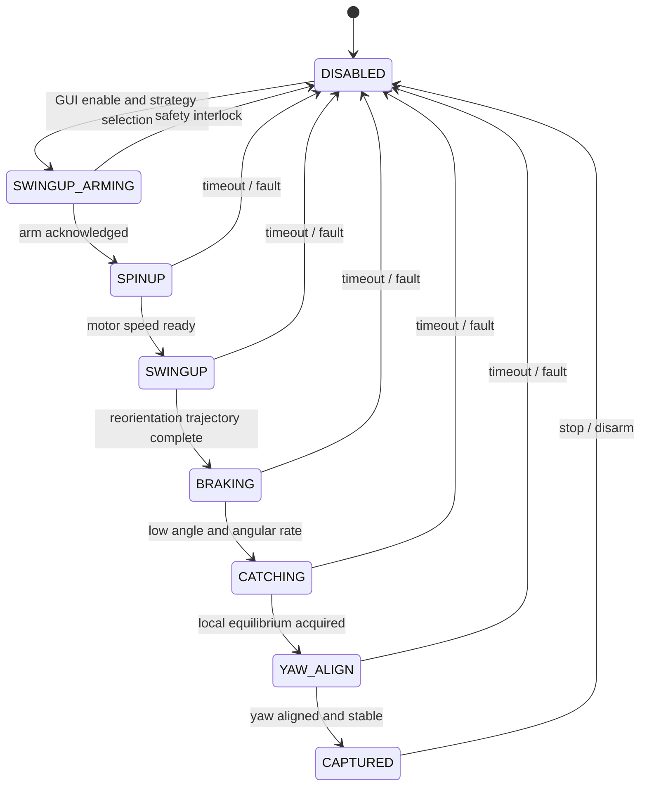
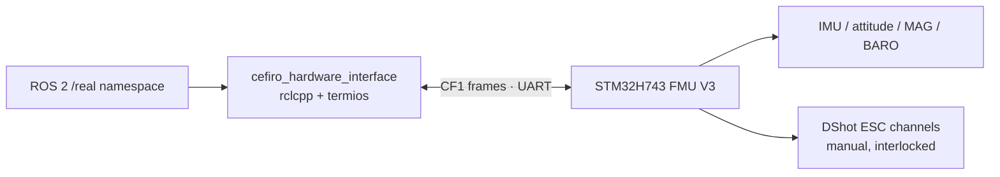
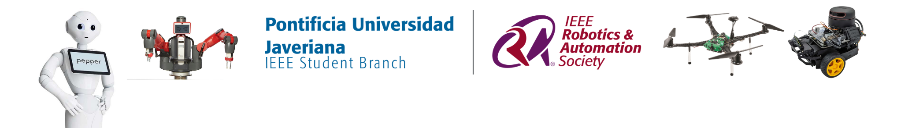

<div align="center">

# PROJECT CEFIRO

### A ROS 2 research platform for quadrotor attitude control, embedded systems, and hardware–simulation integration

**A custom quadrotor mounted on a three-axis gimbal, developed as an end-to-end robotics and control engineering testbed.**

[](https://docs.ros.org/en/jazzy/)
[](https://ubuntu.com/)
[](https://gazebosim.org/docs/harmonic/)
[](https://isocpp.org/)
[](https://www.python.org/)
[](https://www.qt.io/)
[](LICENSE)

**[Architecture](#system-architecture) · [Demonstrations](#demonstrations) · [Packages](#ros-2-workspace) · [Getting started](#getting-started) · [Research roadmap](#research-and-development-roadmap)**

</div>

---

## Overview

**CEFIRO** brings together mechanical design, custom embedded electronics, actuator modeling, physics-based simulation, control theory, and a native human–machine interface. Rather than treating the quadrotor as an ideal free-flying rigid body, the project studies **attitude control on a mechanically constrained, three-degree-of-freedom gimbal**.

The gimbal adds its own inertia, gravity, friction, and kinematic coupling. As a result, the control problem extends beyond standard quadrotor attitude equations: the controller must account for the complete moving assembly, the motor-to-joint torque mapping, and the transition from an initially hanging configuration to the desired upright equilibrium.

The repository is organized around three complementary research tracks:

- **ROS 2 and control:** model-based attitude stabilization, hybrid swing-up/reorientation, LQR, reference tracking, state estimation, and experimental analysis.
- **Gazebo and digital prototyping:** URDF/Xacro modeling, realistic sensor placement, custom rotor wrench application, ESC/motor/propeller dynamics, and repeatable experiments.
- **Embedded systems and hardware integration:** a custom STM32H743-based flight-management board, DShot-oriented motor commands, CF1 serial communication, host-side safety interlocks, and a separate real-hardware ROS 2 namespace.

> **Project status.** The integrated swing-up, capture, and reference-tracking workflows are research implementations for **simulation**. The real-hardware interface supports supervised telemetry and explicitly guarded manual bench workflows; **automatic attitude actuation on the STM32 is currently inhibited by firmware**. Simulated RPM must never be interpreted as real motor-speed feedback.

## Visual overview

<div align="center">
  
  
  
  
</div>

<sub>Images are stored in [`cefiro/public/img`](cefiro/public/img) and correspond to the repository's own Gazebo and RViz resources.</sub>

## Demonstrations

The repository includes **three full-length MP4 recordings**. Select a preview to open the corresponding video file on GitHub. Large, committed MP4 files are linked rather than presented as guaranteed inline players in a README.

|                                                Gazebo model and spawn                                                |                                                     Swing-up and equilibrium control                                                      |                                                    Attitude controller experiment                                                     |
| :------------------------------------------------------------------------------------------------------------------: | :---------------------------------------------------------------------------------------------------------------------------------------: | :-----------------------------------------------------------------------------------------------------------------------------------: |
| [](cefiro/public/video/gz_spawn_robot_test.mp4) | [](cefiro/public/video/swing_up_and_hover_control.mp4) | [](cefiro/public/video/actitude_controller_test.mp4) |
|                    [Watch `gz_spawn_robot_test.mp4`](cefiro/public/video/gz_spawn_robot_test.mp4)                    |                       [Watch `swing_up_and_hover_control.mp4`](cefiro/public/video/swing_up_and_hover_control.mp4)                        |                       [Watch `actitude_controller_test.mp4`](cefiro/public/video/actitude_controller_test.mp4)                        |

The videos are longer experiment recordings rather than edited short clips. They are retained in [`cefiro/public/video`](cefiro/public/video) so the original demonstrations can be inspected without omitting intermediate behavior.

## System architecture



### ROS 2 control architecture: what is implemented today?

CEFIRO deliberately separates the **simulation control path** from the **physical serial interface**:

| Layer                            | Current implementation                              | Responsibility                                                                                              |
| -------------------------------- | --------------------------------------------------- | ----------------------------------------------------------------------------------------------------------- |
| Simulated controller             | `cefiro_control/scripts/cefiro_balance_node.py`     | ROS 2 node running the hybrid swing-up, capture, LQR, and reference-tracking logic                          |
| Multibody dynamics               | `cefiro_control/scripts/cefiro_multibody.py`        | Joint-space kinematics, mass/gravity terms, and motor effectiveness derived from the description parameters |
| Simulation actuators             | `cefiro_actuators`                                  | Four-channel motor/ESC/propeller model, command limits, watchdog, and simulated telemetry                   |
| Gazebo actuation                 | `cefiro_gz/src/rotor_system.cpp`                    | Applies rotor forces and reaction torques to the modeled drone body                                         |
| `ros2_control` controller plugin | `cefiro_control/src/cefiro_attitude_controller.cpp` | A separate C++ `controller_interface` implementation retained for controller-manager integration work       |
| Real hardware bridge             | `cefiro_hardware_interface`                         | Standalone ROS 2 serial node for the STM32 FMU; **not yet a `hardware_interface::SystemInterface` plugin**  |

**Important:** `cefiro_gz/launch/start_gz.launch.py` currently launches the **standalone simulation controller and actuator model**. It does **not** spawn the legacy `ros2_control` controller plugin through `controller_manager`. A future research milestone is to unify the simulation and hardware execution paths through well-defined `ros2_control` command/state interfaces, lifecycle management, and a hardware adapter.

### Mechanical model

The current kinematic chain is:

```text
world
  └── base_link                 fixed foundation
       └── yaw                 narya_ring
            └── pitch          vilya_ring
                 └── roll      nenya_ring
                      └── fixed joint → drone_body_link
                           ├── motor_1 / prop_1_link
                           ├── motor_2 / prop_2_link
                           ├── motor_3 / prop_3_link
                           └── motor_4 / prop_4_link
```

The model is parameterized in [`cefiro_description/config/cefiro_params.yaml`](cefiro_description/config/cefiro_params.yaml), including link masses, center-of-mass estimates, approximate inertias, joint axes, damping, motor locations, rotor order, and spin direction. These quantities should be validated against physical measurements before claiming quantitative agreement with hardware.

The core joint-space dynamics can be expressed as

$$
M(q)\ddot{q}+C(q,\dot{q})\dot{q}+D\dot{q}+g(q)=Q_{\mathrm{motors}},
$$

where the motor-generated body wrench is mapped to the gimbal's generalized joint forces using its actual kinematics. This mapping matters because the innermost gimbal axis is **not identical to the body's nominal Euler roll axis**.

## ROS 2 workspace

| Package / directory                                       | Manifest version | Purpose                                                                                              |
| --------------------------------------------------------- | :--------------: | ---------------------------------------------------------------------------------------------------- |
| [`cefiro_description/`](cefiro_description)               |     `0.0.0`      | CAD-based meshes, URDF/Xacro, inertial parameters, robot description, RViz                           |
| [`cefiro_sensors/`](cefiro_sensors)                       |     `1.0.0`      | Sensor configurations and meshless IMU, magnetometer, and barometer frames                           |
| [`cefiro_gz/`](cefiro_gz)                                 |     `1.0.0`      | Gazebo world, scenario spawning, ROS–Gazebo bridge, custom rotor plugin                              |
| [`cefiro_actuators/`](cefiro_actuators)                   |     `0.1.0`      | ESC/BLDC/propeller model and four-motor telemetry                                                    |
| [`cefiro_control/`](cefiro_control)                       |     `1.0.0`      | Attitude-control algorithms, multibody model, simulation state machine, `ros2_control` plugin source |
| [`cefiro_msgs/`](cefiro_msgs)                             |     `0.1.0`      | Typed messages for motor RPM, DShot, and telemetry                                                   |
| [`cefiro_gui/`](cefiro_gui)                               |     `1.5.1`      | Qt-based control and experiment HMI, 3D attitude display, charts, CSV logging                        |
| [`cefiro_hardware_interface/`](cefiro_hardware_interface) |     `0.4.1`      | ROS 2 ↔ real FMU serial/CF1 bridge, command gating, hardware diagnostics                             |
| [`cefiro_matlab/`](cefiro_matlab)                         |        —         | MATLAB scripts for local linear models, LQR, and swing-up study                                      |
| [`cefiro/`](cefiro)                                       |        —         | Project assets, demonstration recordings, and experiment datasets                                    |

<sub>Versions above are read from each `package.xml` in the repository, not release tags. Some internal component documents have independent release numbering; manifest versions and document versions may differ.</sub>

### Software and toolchain

| Component               | Version / technology                                   | Use in CEFIRO                                                          |
| ----------------------- | ------------------------------------------------------ | ---------------------------------------------------------------------- |
| Operating system        | **Ubuntu 24.04 LTS**                                   | Primary development and simulation environment                         |
| Middleware              | **ROS 2 Jazzy Jalisco**                                | Nodes, topics, typed messages, launch, parameters, and tooling         |
| Simulator               | **Gazebo Harmonic / gz-sim 8**                         | Rigid-body physics, sensors, constraints, and custom system plugin     |
| Robotics visualization  | **RViz 2**                                             | Robot-description and TF inspection                                    |
| Languages               | **C++20**, **Python 3.12**, XML/Xacro, YAML, CMake     | Simulation plugins, nodes, algorithms, configuration, and build system |
| HMI                     | **Qt 6 Widgets / Qt Charts**                           | Desktop control, telemetry, experiment recording                       |
| Control and dynamics    | **Eigen 3**, NumPy, MATLAB with Control System Toolbox | Modeling, numerical methods, LQR design, verification                  |
| Embedded target         | **STM32H743**                                          | Custom FMU V3 with serial telemetry and motor-command firmware         |
| Physical communications | **USART 115200 8N1 / CF1 / CRC16-CCITT**               | Host–FMU protocol and bounded manual commands                          |

The MATLAB scripts are optional for building the ROS workspace, and this repository does not pin a single MATLAB release.

## Getting started

### Prerequisites

Install a working **ROS 2 Jazzy + Gazebo Harmonic** environment on Ubuntu 24.04, including the ROS–Gazebo bridge, Xacro, the usual colcon tools, and the dependencies declared by the packages. The Qt desktop application also requires Qt 6 Widgets/Charts development libraries.

```bash
sudo apt update
sudo apt install -y \
  python3-colcon-common-extensions python3-rosdep \
  ros-jazzy-xacro ros-jazzy-ros-gz \
  ros-jazzy-rviz2 ros-jazzy-joint-state-publisher-gui \
  qt6-base-dev libqt6charts6-dev
```

If `rosdep` has never been initialized on the machine, initialize it once, then update it:

```bash
sudo rosdep init   # Skip if already initialized
rosdep update
```

### Build the workspace

```bash
mkdir -p ~/cefiro_ws/src
cd ~/cefiro_ws/src

git clone https://github.com/Nidhood/PROJECT-CEFIRO.git

cd ~/cefiro_ws
source /opt/ros/jazzy/setup.bash
rosdep install --from-paths src --ignore-src -r -y
colcon build --symlink-install
source install/setup.bash
```

> The repository is ROS-workspace content. `colcon` discovers the ROS packages through their `package.xml` files, even when they are nested below the cloned repository directory. Use a fresh shell or source the workspace in every terminal.

### 1. Visualize the robot description in RViz

```bash
ros2 launch cefiro_description display.launch.py
```

Use the joint-state GUI to examine the model, joint ordering, transforms, and gimbal motion without energizing any motors.

### 2. Launch Gazebo with the simulated controller

```bash
ros2 launch cefiro_gz start_gz.launch.py \
  use_sim_time:=true enable_sensors:=true
```

This launches the world, scenery, quadrotor/gimbal, simulated sensors, actuator node, custom rotor plugin, ROS–Gazebo bridge, and simulation-only attitude-control node.

### 3. Launch the HMI in a separate terminal

```bash
source /opt/ros/jazzy/setup.bash
source ~/cefiro_ws/install/setup.bash
ros2 launch cefiro_gui cefiro_gui.launch.py
```

In the HMI, the **`SWING-UP + LQR (SIM)`** strategy implements a staged progression from an inverted configuration to local attitude stabilization. Angle-reference commands are gated until the controller reports the captured/balanced state. The GUI also contains dashboard, signal-generator, metrics, waveform, and experiment-recording views.

### 4. Observe ROS 2 communication

```bash
ros2 node list
ros2 topic list
ros2 topic echo /cefiro/control/status
ros2 topic echo /cefiro/control/diagnostics
ros2 topic hz /imu/data
```

| ROS topic                            | Message                            | Meaning                                                   |
| ------------------------------------ | ---------------------------------- | --------------------------------------------------------- |
| `/imu/data`                          | `sensor_msgs/msg/Imu`              | Simulated orientation, angular velocity, and acceleration |
| `/magnetometer/data`                 | `sensor_msgs/msg/MagneticField`    | Simulated magnetic-field measurement                      |
| `/bmp581/air_pressure`               | `sensor_msgs/msg/FluidPressure`    | Simulated pressure sensor                                 |
| `/cefiro/control/attitude_reference` | `geometry_msgs/msg/Vector3Stamped` | HMI attitude request in radians                           |
| `/cefiro/control/status`             | `std_msgs/msg/String`              | Controller state and safety feedback                      |
| `/cefiro/control/diagnostics`        | `std_msgs/msg/String`              | Controller diagnostics encoded as JSON text               |
| `/cefiro_actuators/target_rpm`       | `cefiro_msgs/msg/MotorRpm`         | Four requested simulated rotor speeds                     |
| `/cefiro_actuators/telemetry`        | `cefiro_msgs/msg/MotorTelemetry`   | Simulated motor/actuator feedback                         |

Configuration entry points: [`balance_sim.yaml`](cefiro_control/config/balance_sim.yaml), [`actuators.yaml`](cefiro_actuators/config/actuators.yaml), [`gui_config.yaml`](cefiro_gui/config/gui_config.yaml), and [`bridge_config.yaml`](cefiro_gz/config/bridge_config.yaml).

## Attitude-control research

### Hybrid stabilization around an unstable equilibrium

The present simulation workflow treats the suspended quadrotor as a constrained multibody system with a naturally hanging configuration and a desired upright operating equilibrium:



**The nominal swing-up branch is a planned nonlinear reorientation**, followed by explicit braking, blended capture, delayed yaw alignment, and LQR equilibrium control. A conventional energy-injection swing-up is also a subject of study, but should not be conflated with the nominal trajectory-based maneuver.

After capture, the control loop supports conservative body-attitude references with filtering, model-based feedforward, and bounded integral correction. The initial simulation reference envelope in the current configuration is **roll ±5°, pitch ±5°, yaw ±10°**. These values are test settings, **not experimentally certified limits of the physical quadrotor**.

### Topics under investigation

| Area                           | Research questions                                                                                                    |
| ------------------------------ | --------------------------------------------------------------------------------------------------------------------- |
| Constrained multibody dynamics | How do moving-ring inertia, center of mass, and gravity alter the attitude plant?                                     |
| Hybrid systems                 | How can swing-up, braking, equilibrium capture, and local stabilization be switched without losing stability?         |
| LQR and state feedback         | How should the local controller be linearized and tuned around the unstable equilibrium?                              |
| Reference tracking             | What limits closed-loop bandwidth, steady-state error, and cross-axis coupling?                                       |
| Motor allocation               | Which joint torques are achievable after voltage, RPM, slew, and thrust constraints?                                  |
| State estimation               | How can IMU and magnetometer measurements support robust attitude reconstruction?                                     |
| System identification          | Which actuator and damping parameters must be measured instead of assumed?                                            |
| `ros2_control`                 | How can controllers, lifecycle state, and command/state interfaces be shared between simulation and the physical FMU? |

### Data and numerical tools

- [`cefiro_matlab/`](cefiro_matlab): baseline LQR, local-equilibrium analysis, and 1-DOF swing-up examples.
- [`cefiro_control/test/`](cefiro_control/test) and [`cefiro_control/tests/`](cefiro_control/tests): offline regressions of control, actuator limits, multibody behavior, and state-machine transitions.
- [`cefiro/data/LQR/`](cefiro/data/LQR): recorded experiment CSV, metadata, and generated summaries for reproducibility.

The supplied numerical studies and simulated experiments are useful for iteration, but remain distinct from a validated hardware identification campaign.

## Embedded FMU and real-hardware interface

CEFIRO's physical integration targets the custom **CEFIRO FMU V3** based on the **STM32H743**. The host interface is implemented in C++20 and communicates over a USB-to-USART link using the documented **CF1 ASCII protocol with CRC16-CCITT**.

The real system intentionally uses a separate namespace, `/real`, to prevent accidental mixing of simulated and physical command paths.



**Read-only hardware telemetry** is the recommended first integration test. For firmware that implements the documented CF1 protocol:

```bash
ros2 launch cefiro_hardware_interface hardware.launch.py \
  port:=/dev/ttyUSB0 \
  protocol_mode:=cf1 \
  enable_command_tx:=false \
  rpm_to_dshot_enabled:=false
```

Replace `/dev/ttyUSB0` with the actual device path. Real serial telemetry can be inspected using `/real/cefiro/hardware/status` and `/real/imu/data`.

**Hardware safety boundary:** the current FMU firmware intentionally inhibits automatic attitude-output actuation (`CF_ENABLE_AUTOMATIC_OUTPUT=0`); `CMD_RPM` is unsupported and no measured motor RPM is available. DShot/RPM conversion on the host, when explicitly enabled for a supervised bench test, is an **open-loop command mapping** rather than RPM feedback control. Do not connect the simulation swing-up controller directly to physical ESCs.

See the dedicated documentation for actual protocol and interlocks:

- [`cefiro_hardware_interface/README.md`](cefiro_hardware_interface/README.md)
- [`cefiro_hardware_interface/docs/PROTOCOL.md`](cefiro_hardware_interface/docs/PROTOCOL.md)
- [`cefiro_hardware_interface/INSTALLAR_EN_RASPBERRY.md`](cefiro_hardware_interface/INSTALLAR_EN_RASPBERRY.md)
- [`cefiro_actuators/docs/CALIBRATION.md`](cefiro_actuators/docs/CALIBRATION.md)

## Research and development roadmap

The following milestones describe the engineering scope; they are **research stages, not claims that every item is complete or physically validated**.

| Stage                                 | Main focus                                                                     | Deliverable / validation goal                                               |
| ------------------------------------- | ------------------------------------------------------------------------------ | --------------------------------------------------------------------------- |
| **01 — Mechanical foundation**        | Parametric frame and three-axis gimbal, CAD, joints, mass properties           | Consistent URDF/Xacro, joint conventions, measured mass and inertia         |
| **02 — Embedded platform**            | STM32H743 FMU, sensors, DShot, electrical power, UART                          | Reliable sensor telemetry, firmware interlocks, verified motor output       |
| **03 — ROS 2 integration**            | Nodes, messages, launch files, namespaces, diagnostics                         | Reproducible simulation and hardware communication contracts                |
| **04 — Gazebo digital prototype**     | Sensor systems, custom rotor plugin, realistic actuator dynamics               | Measured-vs-simulated motion and actuator-response comparisons              |
| **05 — Attitude stabilization**       | Multibody linearization, LQR, reorientation, hybrid capture                    | Upright capture and disturbance rejection in simulation                     |
| **06 — Tracking and experimentation** | Qt HMI, setpoint generation, CSV, error metrics, actuator identification       | Repeatable tests with documented rise/settling/error metrics                |
| **07 — `ros2_control` convergence**   | `controller_manager`, hardware interfaces, lifecycle and resource ownership    | A tested controller/hardware abstraction across simulation and real devices |
| **08 — HIL and physical validation**  | Hardware-in-the-loop, power safety, rate limits, closed-loop bench experiments | Safe, instrumented progression from software model to measured response     |

### Engineering principles

- Keep **simulation-only automatic control** isolated from physical motor-output authority.
- Treat URDF inertias, coefficients of thrust/drag, and damping as **estimates until validated**.
- Preserve reproducible ROS 2 parameters, experiment records, and explicit units.
- Evaluate closed-loop performance using measured settling time, overshoot, steady-state error, angular rates, and actuator saturation.
- Validate motor direction, propeller handedness, and mechanical clearances before any powered physical test.

## License and attribution

The repository root is distributed under the [BSD 2-Clause License](LICENSE). Individual subpackages may include their own license files or manifest declarations; check those before redistributing specific components or assets.

**PROJECT CEFIRO** — engineering, robotics, and control systems research in the context of **IEEE Robotics and Automation Society (RAS), Pontificia Universidad Javeriana, Bogotá, Colombia**.

<div align="center">
  <a href="https://www.javeriana.edu.co/">
    
  </a>
  <br />
  <sub>IEEE RAS Javeriana · Robotics, Automation, Embedded Systems and Control</sub>
</div>
